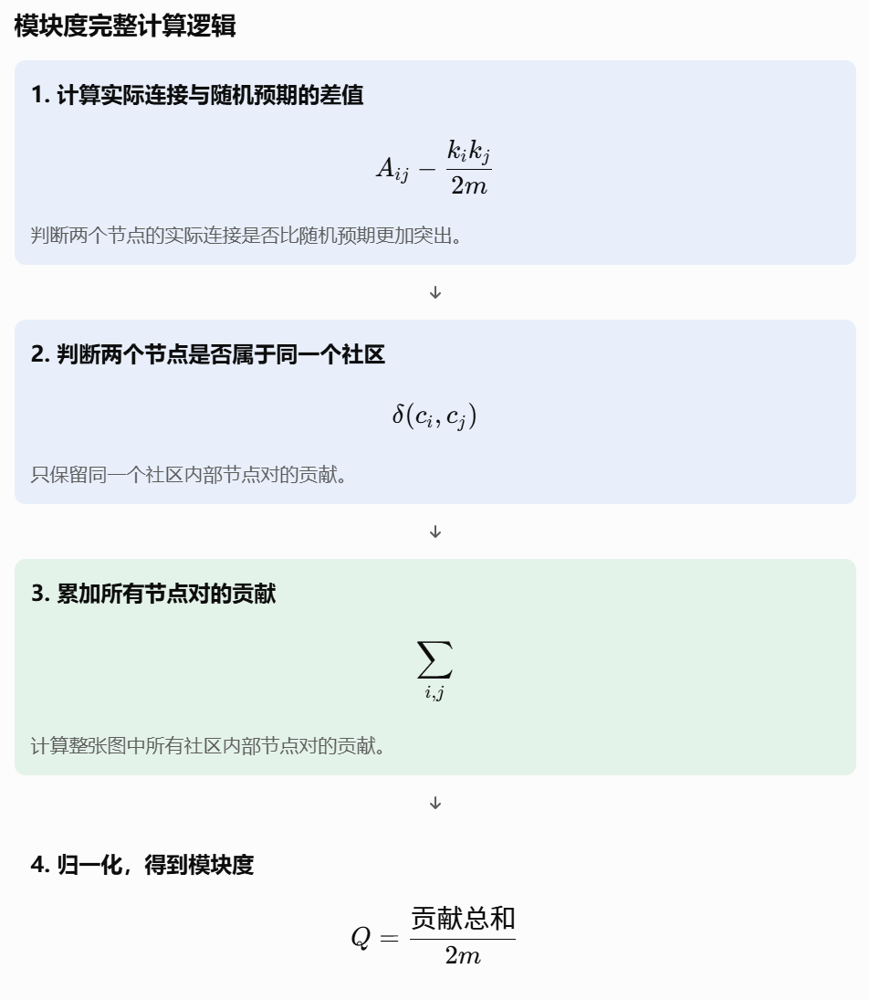
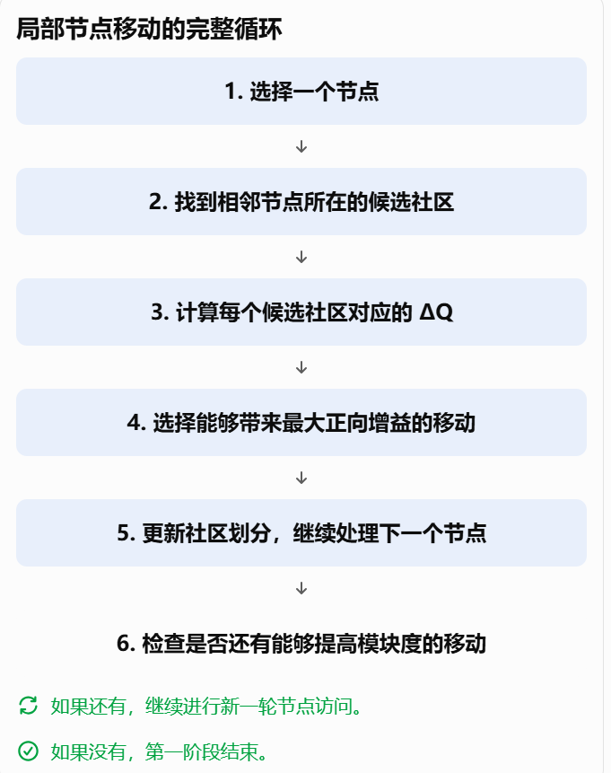
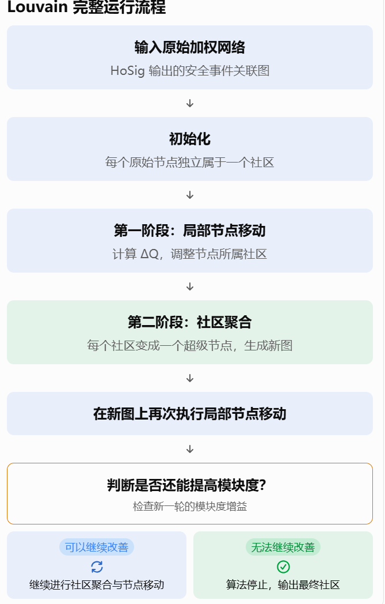

# Louvain 社区发现算法的原理学习

前面的 HoSig 主要解决的是：哪些安全事件之间存在较强的关联？Louvain 解决的是：如何根据这些关联关系，把安全事件组织成不同的社区？

Louvain Algorithm（Louvain 社区发现算法）是一种基于模块度优化的图社区发现算法。

模块度， 它是一种评价图中的分组结构是否合理的指标。

模块度衡量的是：当前社区内部实际存在的连接，是否比随机情况下预期出现的连接更多。

节点的角度： \(Q=\frac{1}{2m}\sum_{i,j} A_{ij}−\frac{k_{i}k_{j}}{2m}δ(c_{i},c_{j})\)

| 符号 | 含义 | 通俗理解 |
| --- | --- | --- |
| \(Q\) | 模块度 | 当前社区划分的评价值 |
| \(A_{ij}\) | 节点 i 和 j 的实际边权重 | 两个事件实际有多强的关联 |
| \(k_{i}\) | 节点 i 的强度 | 节点 i 与其他节点的边权重之和 |
| \(k_{j}\) | 节点 j 的强度 | 节点 j 与其他节点的边权重之和 |
| \(m\) | 网络总边权重 | 所有无向边的权重之和 |
| \(c_{i}\) | 节点 i 所属的社区 | 事件 i 被分配到哪个社区 |
| \(δ(c_{i},c_{j})\) | Kronecker 符号 | 判断两个节点是否属于同一个社区 |

Louvain 第一阶段——局部节点移动 （ 单个节点 ） -每次访问的次序由随机种子决定

Louvain 通过局部节点移动和社区聚合，利用网络中的局部连接关系进行多层次社区优化。在稀疏图上，它通常具有较好的实际计算效率。

Louvain 的计算量主要取决于节点数量、边数量，以及算法需要进行多少轮节点移动和社区聚合。

\(O(S(N+E))\)

| 符号 | 含义 |
| --- | --- |
| \(N\) | 网络中的节点数量 |
| \(E\) | 网络中的边数量 |

社区的角度： \(Q=\sum_{C} \frac{L_{C}}{m}−\frac{d_{C}}{2m}^{2}\)

\(L_{C}=社区内部所有边的权重之和\)

\(d_{C}=\sum_{i∈C} k_{i}\) 把一个社区内部所有节点的连接强度加起来。

模块度的增益： \(ΔQ=Q_{移动后}−Q_{移动前}\)

\(ΔQ_{i→C}=\frac{k_{i,in}}{m}−\frac{k_{i}Σ_{tot}}{2m^{2}}\)

| 符号 | 含义 |
| --- | --- |
| \(k_{i,in}\) | 节点 i 与候选社区 C 内所有节点之间的边权重之和 |
| \(k_{i}\) | 节点 i 的总连接强度 |
| \(Σ_{tot}\) | 候选社区 C 中所有节点的总连接强度 |
| \(m\) | 整张网络的总边权重 |

第二阶段：社区聚合

这些已经形成的社区之间，是否还存在更高层次的社区结构？ -> 把已经形成的每个社区压缩成一个新的节点。

如何压缩节点： 将社区内部的边权重保留为超级节点上的自环（Self-loop）。

如何处理边权： 两个社区之间原本有多条边，聚合后就合并为一条边，边权重等于原来所有跨社区边权重之和。

分辨率参数： 控制 Louvain 社区划分颗粒度的参数。

\(Q_{γ}=\frac{1}{2m}\sum_{i,j} A_{ij}−γ\frac{k_{i}k_{j}}{2m}δ(c_{i},c_{j})\)

也就是说，\(\gamma\) 可以调整模块度对随机预期连接的惩罚力度。

这里非常重要：

- \(γ\) 越大，随机预期基准被放大。

- \(γ\) 越小，随机预期基准被缩小。

| 场景中的问题 | Louvain 的解决方案 | 解决目的 |
| --- | --- | --- |
| 事件之间关联强度不同，难以判断社区划分是否合理 | 模块度优化 | 寻找内部连接相对突出的社区 |
| 事件数量较多，需要逐步确定社区归属 | 局部节点移动 | 逐步调整事件所属社区 |
| 初步社区之间仍存在关联 | 社区聚合 | 在更高层次网络上继续发现社区 |
| 边缘侧计算资源有限 | Louvain的时间复杂度是基于边书和社区的数量的 | 提高社区发现的计算效率 |
